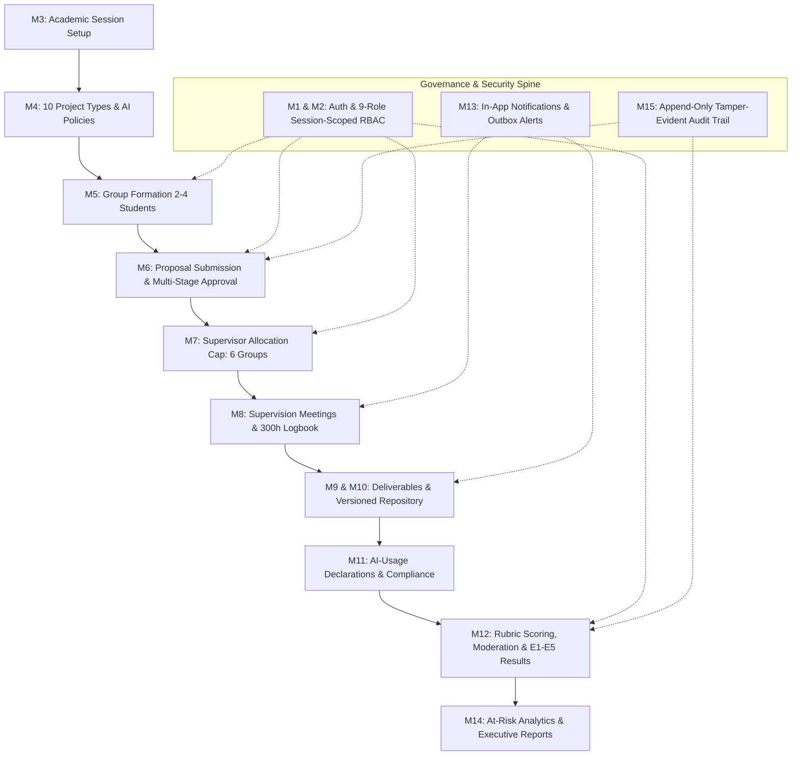
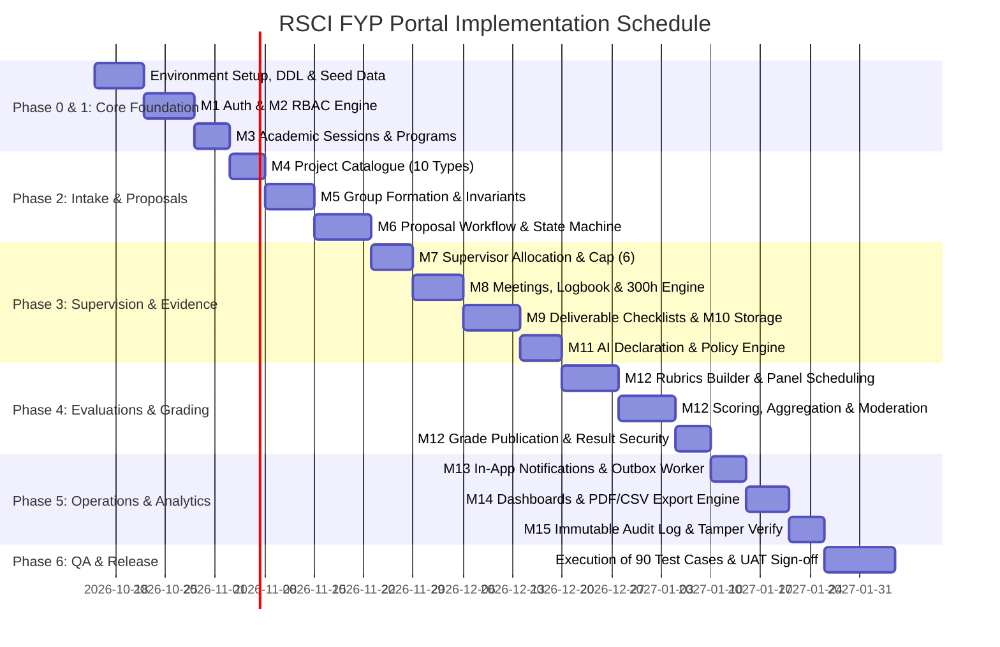
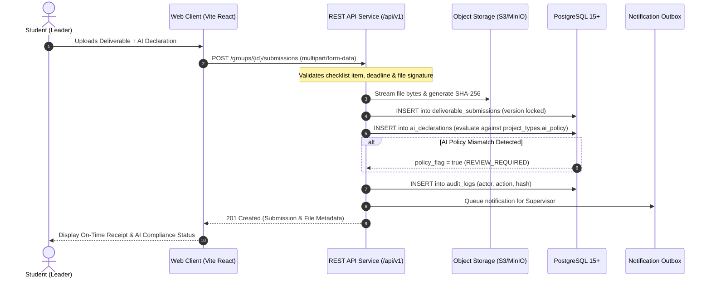

# RSCI FYP Portal — Master Development Plan (v1.0)
**Project:** Centralized Multi-Domain Final Year Project Management Portal  
**Institution:** Riphah School of Computing & Innovation (RSCI)  
**Governing Documents:** SRS v1.0 · SDD v1.0 · Database Design v1.0 · REST API Spec v1.0 · Test Plan v1.0 · FYP Framework v1.0  
**Baseline Date:** October 2026

---

## 1. Executive Summary & System Vision

The **RSCI FYP Portal** is an enterprise-grade academic platform designed to manage the entire capstone project lifecycle across **10 distinct computing project types** and **9 specialized user roles**. It replaces fragmented workflows with a unified, auditable, evidence-driven, and policy-governed system.

### Core System Invariants
1. **Strict Session & Role Scoping**: All operational data (groups, proposals, allocations, evaluations) is strictly partitioned by `academic_session`.
2. **Immutable Academic Truth**: Submissions, signed minutes, evaluation score sheets, and audit entries are immutable version chains.
3. **Multi-Domain Adaptability**: Support for all 10 project categories (Product Dev, Entrepreneurial, Continuation, Research, IoT/Embedded, Case Study, and 4 Consulting specializations) with tailored deliverable checklists, rubric variants, and granular AI-usage policies.
4. **Separation of Duties**: Clean demarcation between assessment scoring (Internal/External Evaluators), moderation (Chairs/Coordinators), and formal grade publication (Coordinator/HOD).

---

## 2. Recommended Technology Stack & Architecture

To satisfy **NFR-PE-01** (p95 < 2s for 500 concurrent users), **NFR-SE-01–06** (OWASP ASVS compliance), and the relational schema integrity rules:

### A. Core Architecture
- **Monorepo / Clean Separation Architecture**:
  - `apps/server`: Node.js + TypeScript (Express / Fastify) REST API engine conforming strictly to OpenAPI 3.1 & REST API Spec v1.0.
  - `apps/web`: React 18+ (Vite + TypeScript) with modern, accessible, responsive design system (WCAG 2.1 AA compliant, Vanilla CSS custom design tokens, dark/light theme, high-contrast states).
  - `packages/shared`: Shared types, DTOs, enum registries, and validation schemas (Zod).

### B. Database & Persistence Layer
- **RDBMS**: PostgreSQL 15+ with extensions `pgcrypto` (`gen_random_uuid()`) and `citext` (case-insensitive emails).
- **ORM / Query Engine**: Prisma or Drizzle ORM + raw SQL triggers for deferrable constraints, state validation, and monotonic version counters.
- **Cache & Rate Limiting**: Redis for token blacklisting, session-level permission caching, and sliding-window rate limiting (10 attempts / 15 min login; 600 reads / 5 min; 120 writes / 5 min).

### C. File Storage & Security Pipeline
- **Object Storage**: S3-compatible storage (MinIO for local dev/testing; AWS S3 or institutional Ceph in production).
- **Security Pipeline**: Multipart upload with temporary quarantine -> ClamAV / VirusTotal scanner hook -> SHA-256 checksum generation -> short-lived signed URL generation (no public bucket access).

---

## 3. Detailed Phased Implementation Roadmap

### Phase 0: Project Setup & Database Baseline (Week 1)
- Initialize repository with clean directory structure:
  - `server/` (TypeScript API, PostgreSQL connection pool, migration scripts, middleware)
  - `web/` (React + Vite + Vanilla CSS design tokens, state stores, view components)
  - `shared/` (Zod schemas, types, error codes)
- Implement starter DDL migrations from DB Design Doc:
  - Extensions (`pgcrypto`, `citext`)
  - Enums (`ai_policy`, `group_status`, `member_role`, `proposal_status`, `review_decision`, `allocation_role`, `meeting_mode`, `meeting_status`, `attendance_status`, `action_status`, `submission_status`, `submission_decision`, `ai_usage_level`, `evaluation_stage_status`, `evaluation_status`, `panel_role`)
  - Tables: `users`, `roles`, `permissions`, `role_permissions`, `user_roles`, `academic_sessions`, `programs`, `session_programs`, `project_types`
- Seed initial data:
  - 9 roles: `SUPER_ADMIN`, `FYP_COORDINATOR`, `HOD`, `SUPERVISOR`, `CO_SUPERVISOR`, `STUDENT`, `INTERNAL_EVALUATOR`, `EXTERNAL_EXAMINER`, `INDUSTRY_PARTNER`
  - 10 FYP categories from RSCI Framework v1.0 with initial AI policy text
  - Initial programs (`CS`, `SE`, `IT`, `AI`, `DS`, `CY`, `CGV`)

### Phase 1: Identity, RBAC & Academic Governance (Weeks 2–3)
- **M1 User Management**:
  - Secure authentication via email/password (Argon2id hashing).
  - Short-lived JWT (15 min) + rotating refresh token (30 days) stored as salted hash in DB with reuse detection family revocation.
  - Configurable lockout policy (5 failed attempts -> 15 min lock).
  - CSV bulk import endpoint for student and supervisor rosters with validation preview, atomic processing, and downloadable rejection error logs.
- **M2 Role-Based Access Control**:
  - Contextual permission evaluator checking `user_id`, `role_id`, `session_id`, `group_id`, and stage authorization.
  - Active role switcher for multi-role users (e.g. faculty acting as Supervisor vs. Internal Evaluator).
- **M3 Academic Session Management**:
  - Session CRUD with status progression (`DRAFT` -> `ACTIVE` -> `CLOSED` -> `ARCHIVED`).
  - Strict enforcement: exactly 1 session `ACTIVE` at any given time.
  - Academic calendar with milestone deadlines and evaluation blackout dates.

### Phase 2: Catalogue, Groups & Proposal Workflow (Weeks 4–5)
- **M4 Multi-Domain Project Catalogue**:
  - Administration of 10 project categories with eligible programs, objectives, and AI policy rules.
  - Policy snapshotting: approved groups lock the active policy version so retroactive changes don't silently alter requirements.
- **M5 Group Formation & Registration**:
  - Student group creation, leader designation, invitation system.
  - Concurrency-safe group code generator (`FYP-<session_token>-<001>`).
  - Invariants: 2–4 students per group; 1 group per student per session; 1 leader per group.
- **M6 Proposal Submission & Multi-Stage Approval**:
  - Form validation: title, domain, abstract, problem statement, objectives, scope, methodology, timeline.
  - State machine: `DRAFT` -> `SUBMITTED` -> `UNDER_SUPERVISOR_REVIEW` -> `UNDER_COORDINATOR_REVIEW` -> `APPROVED` (with `REVISION_REQUIRED` & `REJECTED` loops).
  - Optimistic locking via `If-Match` / `version` field to eliminate race conditions.
  - Append-only review history linking comments and conditions.

### Phase 3: Supervision, Logbooks, Deliverables & AI Policy (Weeks 6–8)
- **M7 Supervisor Allocation**:
  - Faculty profiles with expertise tags and active workload calculation.
  - Student ranked preferences collection during allocation window.
  - Coordinator allocation console: automated conflict detection, expertise matching score, hard load cap enforcement (default: 6 active groups per supervisor).
- **M8 Meetings & 300-Hour Logbook**:
  - Meeting scheduler (in-person/online, agenda, participant invite).
  - Attendance marking (`PRESENT`, `ABSENT`, `EXCUSED`).
  - Minutes draft -> supervisor sign-off lock (immutable once signed; amendment trail for corrections).
  - Effort tracking: individual hours categorized (Research, Design, Build, Test, Document, Meeting) rolled up toward 300-hour requirement with weekly 9-hour guideline indicator.
- **M9 & M10 Milestones, Deliverable Checklists & Storage**:
  - Automated checklist generation merging 15 Common Framework Obligations with type-specific deliverables.
  - Document upload pipeline: virus scan quarantine -> SHA-256 verification -> signed URL distribution.
  - Late submission detection based on institutional timezone and approved extensions.
  - Prevention of IDOR: students/supervisors cannot access documents outside their allocated groups.
- **M11 AI-Usage Declarations**:
  - Mandatory AI declaration attached to each deliverable submission.
  - Four normalized tiers (`NONE`, `API_ONLY`, `EXTENSIVE`, `LIMITED`).
  - Automated rule check against project type: flagging mismatches for human review (e.g., extensive AI on Research or Product Development).
  - Supervisor attestation workflow.

### Phase 4: Evaluations, Rubrics, Moderation & Publication (Weeks 9–10)
- **M12 Evaluation Stages & Rubric Builder**:
  - 5 configurable evaluation stages:
    - **E1**: Proposal Defense (10%)
    - **E2**: Mid-Term Evaluation (20%)
    - **E3**: Continuous Supervisor Assessment (10%)
    - **E4**: Final Demonstration (30%)
    - **E5**: Final Report & Oral Defense / Viva (30%)
  - Interactive Rubric Builder enforcing criterion weights totaling 100%.
  - Type-specific rubric variants (e.g. Research emphasizing novelty/paper draft; Entrepreneurial emphasizing MVP/financials; Consulting emphasizing client presentation).
- **Panel Scoring, Moderation & Publication**:
  - Panel configuration (Chair, Internal Evaluator, External Examiner).
  - Blind/independent score entry with criterion-level point bounds checks.
  - Aggregation engine: normalized mean percentage computation.
  - Formal moderation workflow: variance flagging, audit-logged score adjustments with mandatory justification.
  - Strict publication gate: results hidden from students until coordinator/HOD approves publication.

### Phase 5: Notifications, Dashboards, Reports & Audit (Weeks 11–12)
- **M13 Notifications & Announcements**:
  - In-app notification center + transactional email dispatch via outbox pattern.
  - Targeted announcements scoped by session, program, role, or group.
- **M14 Dashboards & Analytics**:
  - Role-tailored dashboards:
    - Student: timeline progress, upcoming deadlines, effort rollup, meeting schedule, published feedback.
    - Supervisor: assigned groups, pending minute sign-offs, pending deliverable reviews, workload stats.
    - Coordinator / HOD: at-risk groups radar (missed milestones, low effort hours <9h/wk), allocation load distribution, evaluation completion KPIs.
  - CSV & PDF export engine with filter preservation and institutional watermarking.
- **M15 Audit Trail & Governance**:
  - Append-only `audit_logs` storing actor, role, session, action, target entity, request ID, masked IP, and before/after JSON states.
  - Tamper-evident verification routine (SHA-256 state chaining).
  - Permission-controlled read access (Super Admin, Coordinator, HOD).

### Phase 6: Full QA Verification & Handover (Weeks 13–14)
- Automated execution of all **90 test cases** detailed in the Test Plan (TC-UM-01 to TC-AU-06).
- Performance & load testing (k6 suite simulating 500 concurrent authenticated users with p95 < 2s).
- Security audit (OWASP Top 10, IDOR penetration, SQL injection prevention, file execution prevention).
- Accessibility audit against WCAG 2.1 Level AA.
- Disaster recovery & restore drills (simulating RPO = 24h, RTO = 8h).

---

## 4. Architecture & Data Flow Overview

---

## 5. UI/UX Design System Specifications

To guarantee an exceptional user experience that satisfies the modern aesthetic guidelines:
- **Design Tokens**:
  - Colors: Deep slate background (`#0B0F19`), rich dark surfaces (`#111827`, `#1F2937`), accent cyan (`#06B6D4`), electric blue (`#3B82F6`), emerald for compliant/passed states (`#10B981`), amber for revision required (`#F59E0B`), and rose for rejections/policy flags (`#F43F5E`).
  - Typography: Inter / Plus Jakarta Sans for ultra-crisp digital readability.
  - Layout: Collapsible hierarchical sidebar, role-indicator badges, persistent academic session context, breadcrumb trail.
- **Component Primitives**:
  - Dynamic Kanban board for milestone submission progression.
  - Live effort gauge chart (300-hour ring progress + weekly 9-hour bar breakdown).
  - Split-screen rubric evaluation console with criterion sliders, descriptors, and real-time total calculator.
  - Interactive CSV bulk-import previewer with cell-level error highlighting.

---

## 6. Traceability Matrix to Requirements

| Module | Requirements | Database Entities | API Endpoints | Test Plan Coverage |
| :--- | :--- | :--- | :--- | :--- |
| **M1: User & Auth** | FR-UM-01..05 | `users`, `user_roles` | `/auth/login`, `/auth/refresh`, `/users` | TC-UM-01..06 |
| **M2: RBAC** | FR-RB-01..04 | `roles`, `permissions`, `role_permissions` | `/auth/me`, Session-scoped guards | TC-RB-01..06 |
| **M3: Sessions** | FR-AS-01..05 | `academic_sessions`, `programs` | `/sessions`, `/sessions/{id}/calendar` | TC-SE-01..06 |
| **M4: Catalogue** | FR-PC-01..05 | `project_types` | `/project-types` | TC-PT-01..06 |
| **M5: Groups** | FR-GR-01..05 | `project_groups`, `group_memberships` | `/groups`, `/groups/{id}/members` | TC-GR-01..06 |
| **M6: Proposals** | FR-PR-01..06 | `proposals`, `proposal_reviews` | `/proposals`, `/proposals/{id}/reviews` | TC-PR-01..06 |
| **M7: Supervision** | FR-SA-01..05 | `faculty_profiles`, `supervision_allocations`| `/faculty`, `/allocations` | TC-SA-01..06 |
| **M8: Meetings/Effort** | FR-MT-01..06 | `meetings`, `meeting_minutes`, `effort_entries`| `/groups/{id}/meetings`, `/effort-summary`| TC-MT-01..06 |
| **M9: Deliverables** | FR-DL-01..05 | `milestones`, `deliverable_templates` | `/deliverable-templates`, `/submissions` | TC-MS-01..06 |
| **M10: Documents** | FR-DR-01..04 | `deliverable_submissions`, object storage | `/files/{id}/download`, storage adapters | TC-DR-01..06 |
| **M11: AI Compliance** | FR-AI-01..05 | `ai_declarations` | `/submissions/{id}/ai-declaration` | TC-AI-01..06 |
| **M12: Evaluations** | FR-EV-01..07 | `evaluation_stages`, `rubrics`, `scores` | `/evaluations`, `/scores`, `/moderate` | TC-EV-01..06 |
| **M13: Messaging** | FR-NC-01..04 | `notifications`, `announcements` | `/notifications`, `/announcements` | TC-NT-01..06 |
| **M14: Analytics** | FR-AN-01..04 | Reporting views & materialized tables | `/reports/groups-summary`, `/reports/*` | TC-RP-01..06 |
| **M15: Audit** | FR-AU-01..03 | `audit_logs` | `/audit-logs` | TC-AU-01..06 |

---

## 7. Immediate Next Actions

To begin implementation in `d:\Apps\FYP_Portaal`:
1. **Initialize Project Foundation**: Scaffold the workspace with TypeScript backend API, database migration tooling, and modern frontend application.
2. **Execute Database Migration & Seeding**: Deploy PostgreSQL schemas, tables, triggers, and the 10 Project Types & 9 Roles baseline catalogue.
3. **Build Core Authentication & Session Shell**: Establish JWT/Refresh auth, session scoping, and role-based routing.
